# CONCRAST

Website and administration system for a construction and architecture business.

A public website with projects, services and quotation requests, a visual content editor and an administration panel, backed by one API.

> **Structure only.** The source code is private. Source files here are intentionally empty so you can see how the project is organized. Commands describe the private codebase.

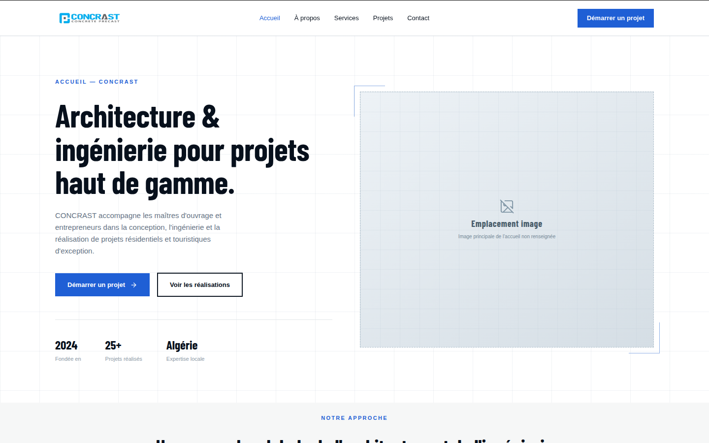

## Features

- Portfolio and services
- Quotation requests with statuses
- Visual page editor with publication versions
- Real-time updates
- Responsive design

## Applications

| Application | Role |
| --- | --- |
| [API server](server-side/README.md) | Express, Sequelize and PostgreSQL |
| [Public website](client-side/README.md) | React website |
| [Administration](admin-side/README.md) | React administration |
| [Deployment](deployment/README.md) | Server setup scripts |

## Architecture

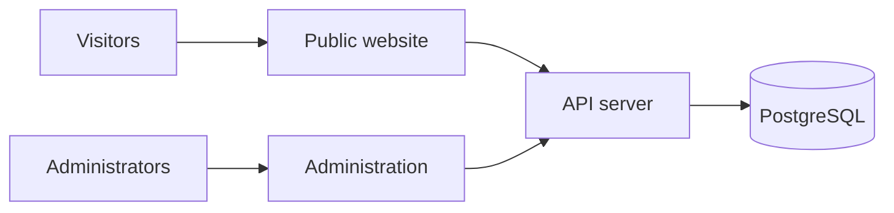

## Engineering highlights

- Uploads are checked by content, re-encoded and stripped of metadata
- Only published media is reachable publicly
- Database trigger protects the main administrator
- Publication history

## Screenshots

| Home | Services |
| --- | --- |
|  | 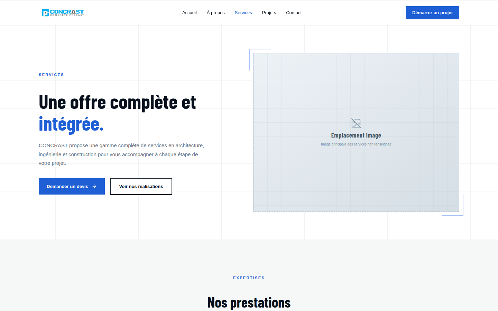 |
| **Projects** | **Contact** |
| 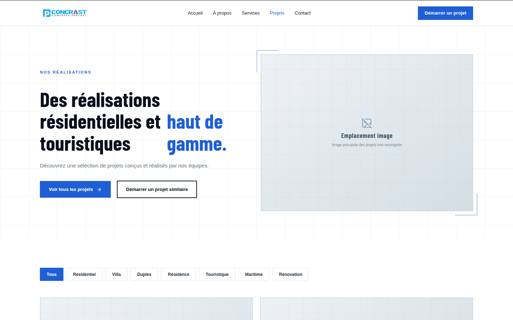 | 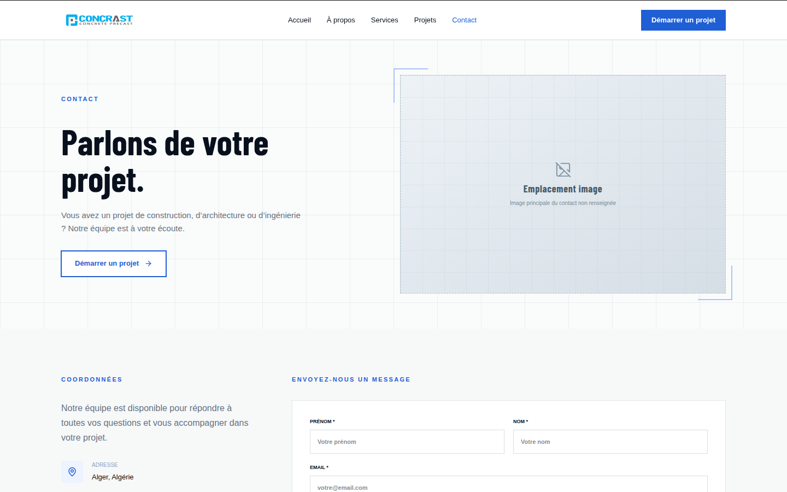 |
| **Dashboard** | **Site editor** |
| 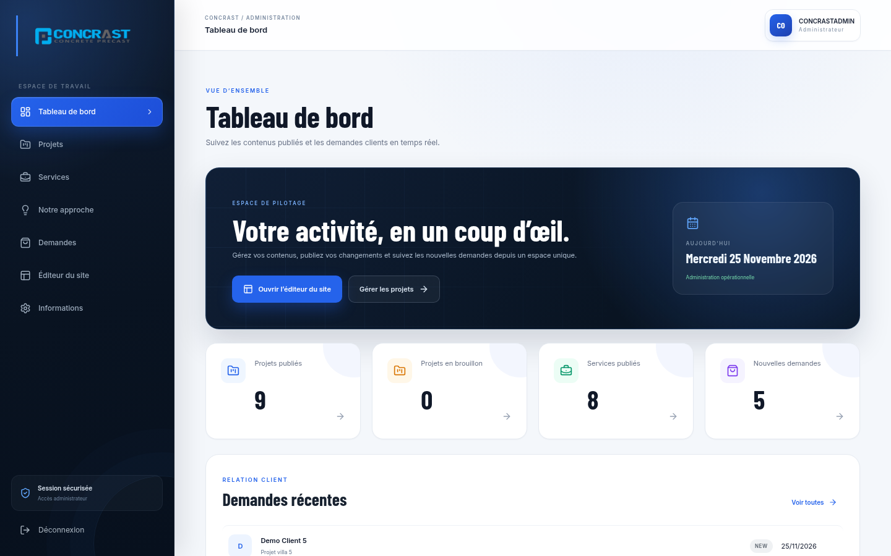 | 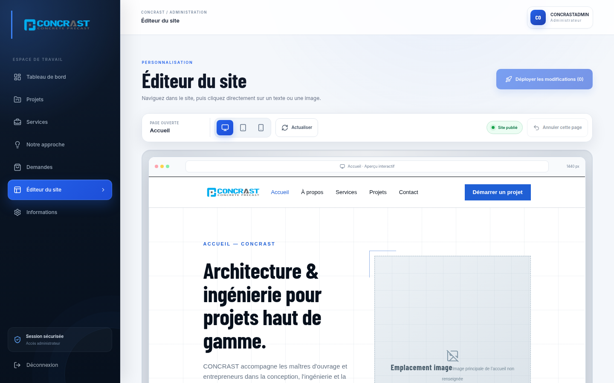 |
| **Projects** | **Services** |
| 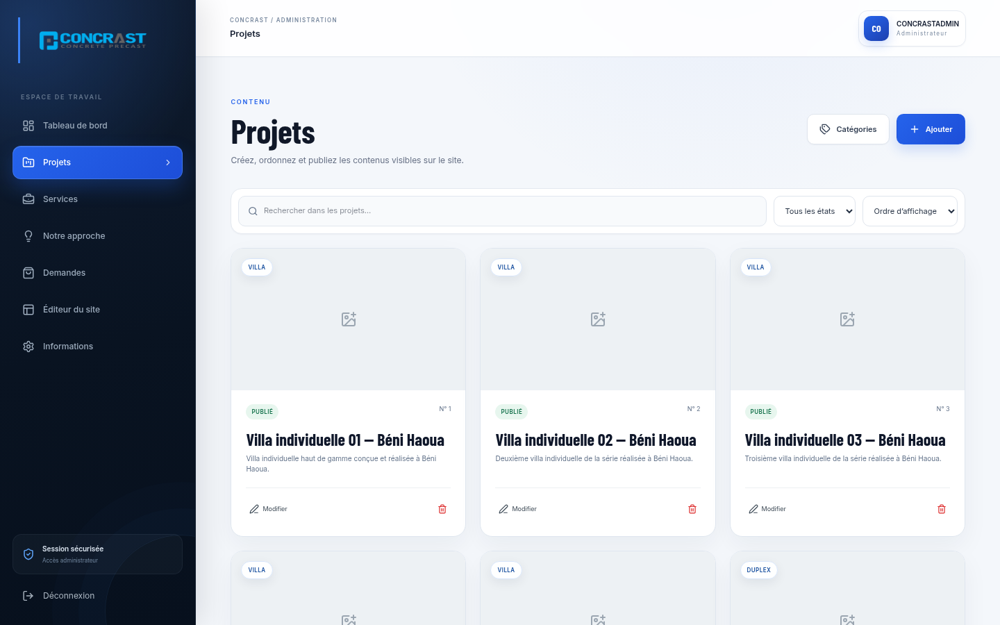 | 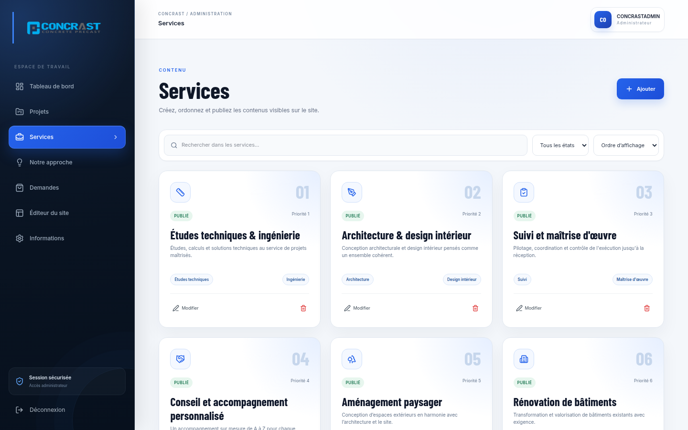 |
| **Requests** | **Business information** |
| 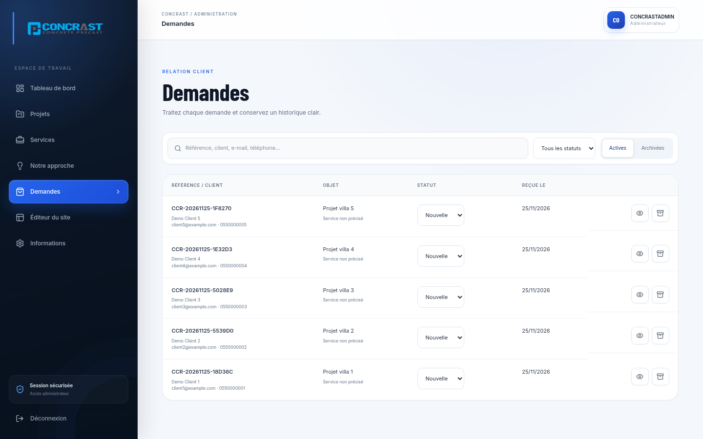 | 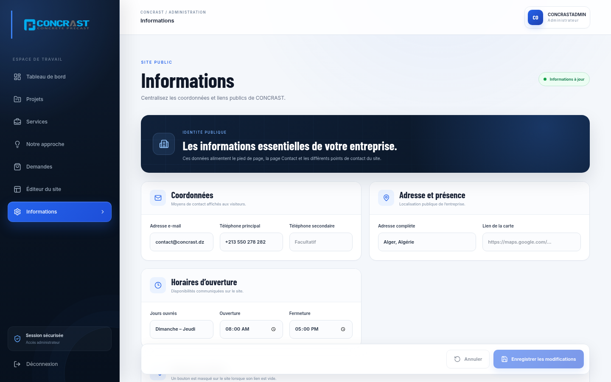 |
| **Sign in** |
| 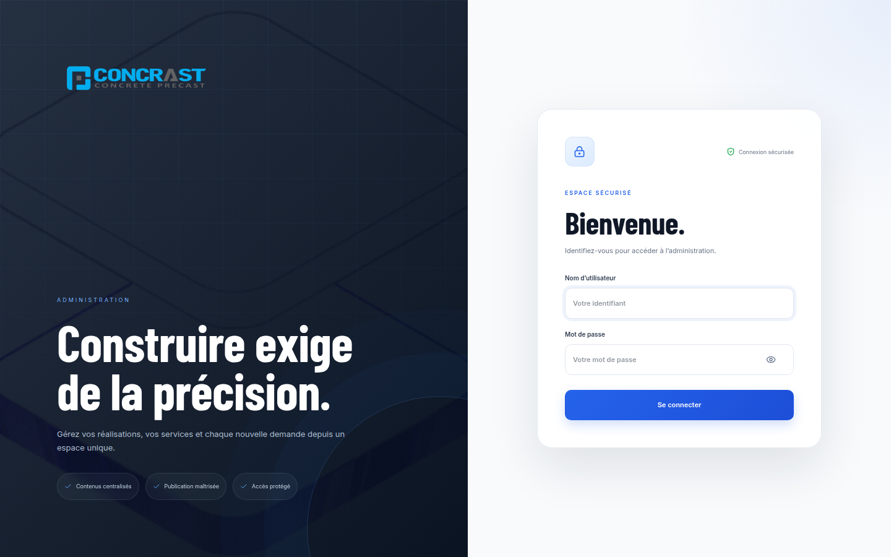 |

Captured on a local demo database without the production photos, so image slots show placeholders.

## Repository layout

```text
server-side/                            Express, Sequelize and PostgreSQL
client-side/                            React website
admin-side/                             React administration
deployment/                             Server setup scripts
docs/screenshots/
```

Each application has its own README with responsibilities, dependencies, structure and commands.

## Usage

Published for portfolio and presentation purposes. No license is granted for reuse.
