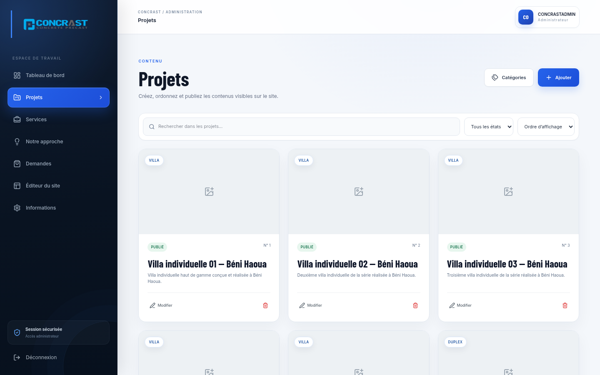
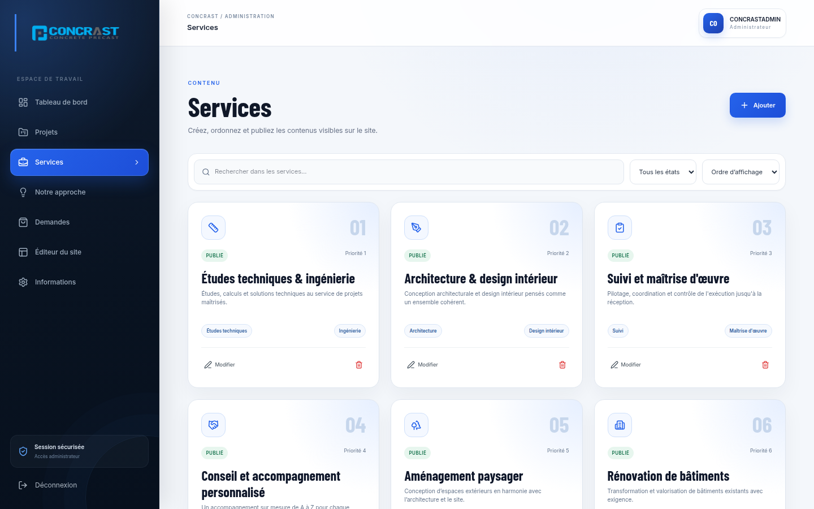
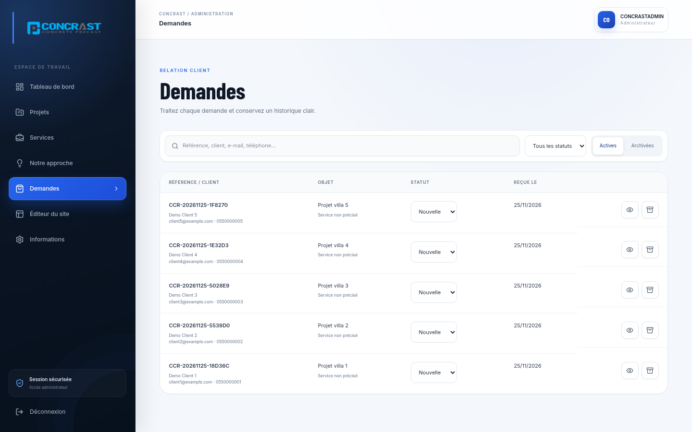

# Administration

React administration. Part of [CONCRAST](../README.md).

> **Structure only.** The source code is private. Source files here are intentionally empty so you can see how the project is organized. Commands describe the private codebase.

## Responsibilities

- Dashboard and requests
- Projects, services and approach
- Business information
- Visual site editor with device preview

## Screenshots

| Dashboard | Site editor |
| --- | --- |
|  |  |
| **Projects** | **Services** |
|  |  |
| **Requests** | **Business information** |
|  |  |
| **Sign in** |
|  |

## Main dependencies

`@hookform/resolvers`, `@tailwindcss/vite`, `@tanstack/react-query`, `axios`, `lucide-react`, `react`, `react-dom`, `react-hook-form`, `react-router-dom`, `socket.io-client`, `tailwindcss`, `zod`

## Structure

```text
public/                           3 files
src/apis/                         7 files
src/app/                          3 files
src/assets/                       3 files
src/components/                   5 files
src/constants/                    2 files
src/hooks/                        6 files
src/                              2 files
src/pages/                        10 files
src/schemas/                      2 files
src/services/                     6 files
src/tests/                        6 files
src/utils/                        1 file
```

## Commands

```bash
npm install
npm run dev
npm run build
npm test
npm run lint
```
