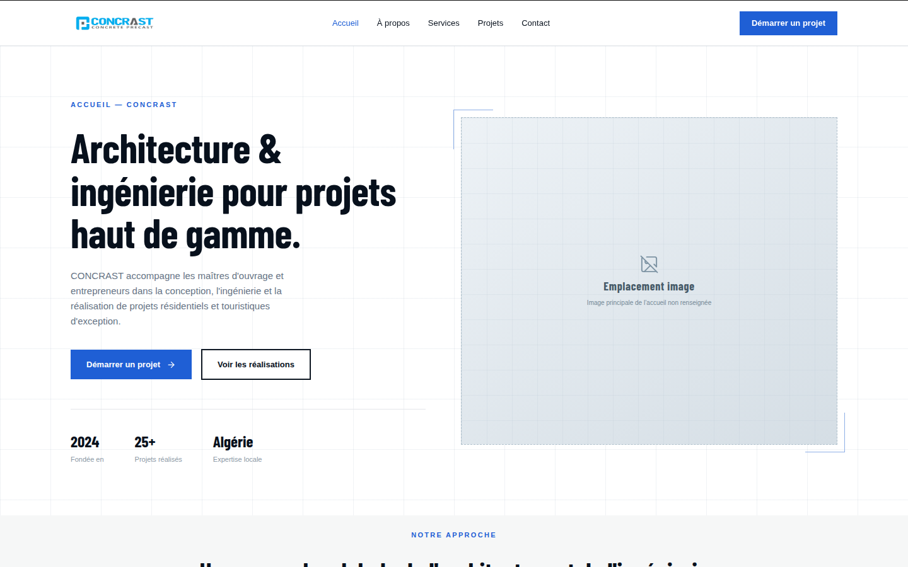
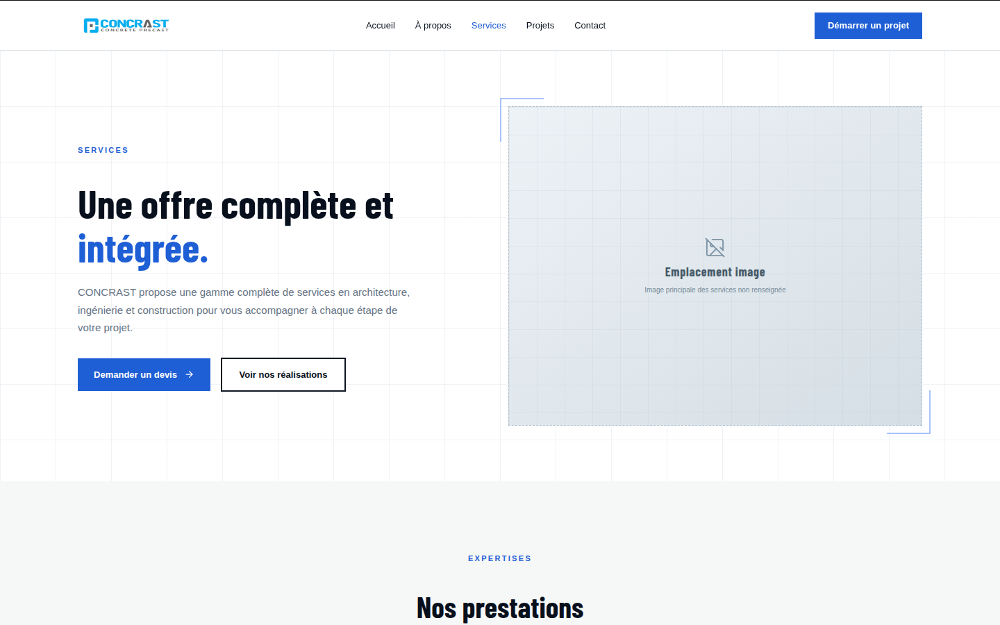
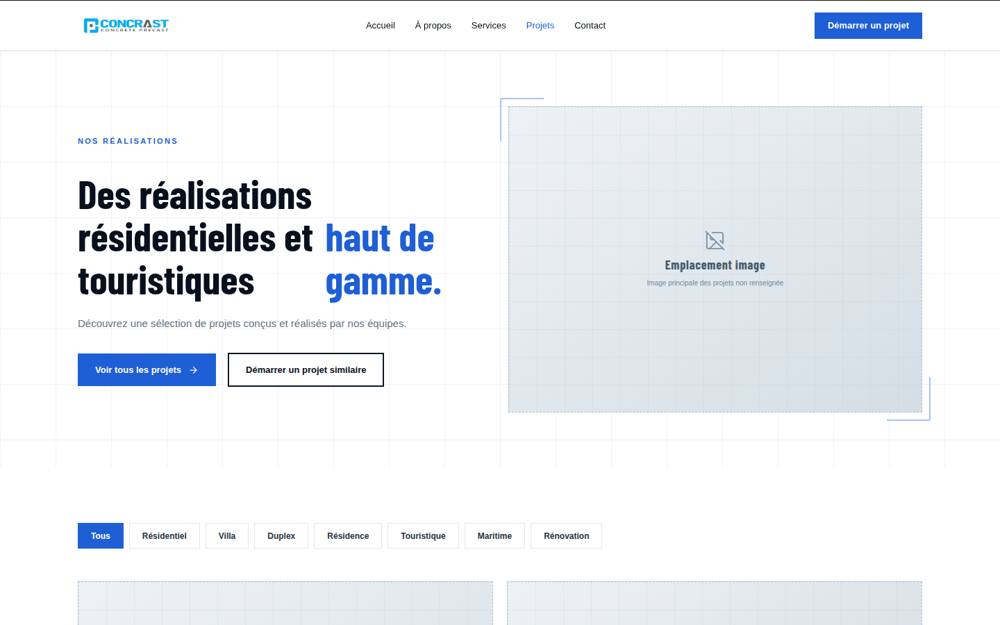
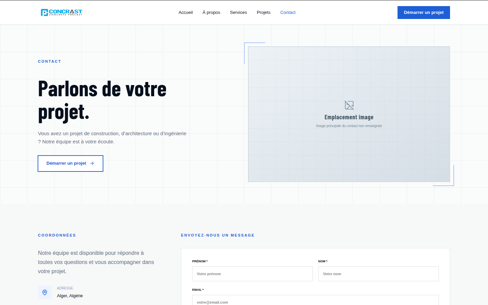

# Public website

React website. Part of [CONCRAST](../README.md).

> **Structure only.** The source code is private. Source files here are intentionally empty so you can see how the project is organized. Commands describe the private codebase.

## Responsibilities

- Home, services, projects, about and contact
- Live content updates
- Offline snapshot fallback

## Screenshots

| Home | Services |
| --- | --- |
|  |  |
| **Projects** | **Contact** |
|  |  |

## Main dependencies

`@hookform/resolvers`, `@tailwindcss/vite`, `@tanstack/react-query`, `lucide-react`, `react`, `react-dom`, `react-hook-form`, `react-router-dom`, `socket.io-client`, `tailwindcss`, `zod`

## Structure

```text
.visual-analysis/                 1 file
public/                           9 files
scripts/                          1 file
src/apis/                         2 files
src/app/                          3 files
src/assets/                       3 files
src/components/                   10 files
src/constants/                    1 file
src/hooks/                        2 files
src/                              2 files
src/pages/                        6 files
src/schemas/                      1 file
src/services/                     2 files
src/tests/                        7 files
```

## Commands

```bash
npm install
npm run dev
npm run build
npm test
npm run lint
```
